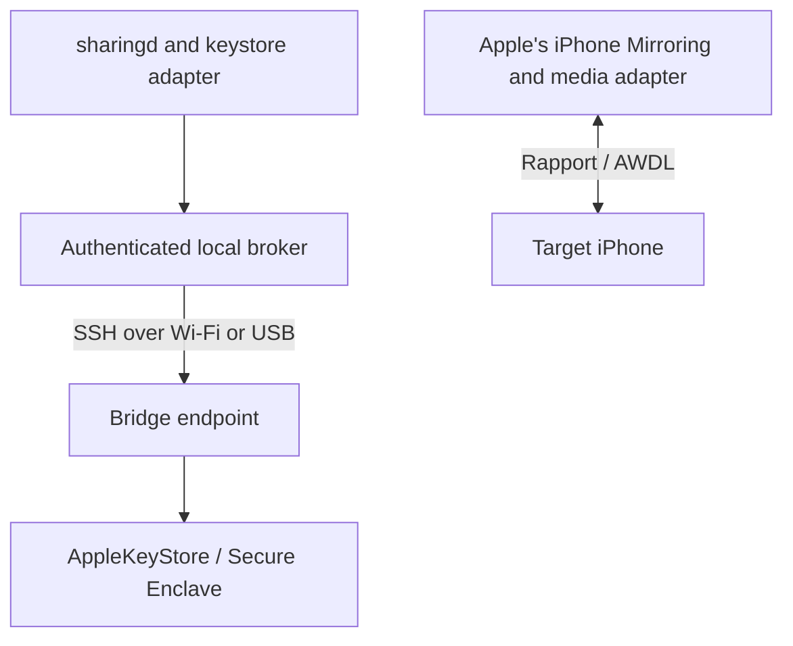

# Architecture

## Modules

| Directory | Responsibility |
| --- | --- |
| `src/app/` | AppKit interface, controls, artwork, setup and secure password entry |
| `src/mirroring/` | Media, keystore, launch, socket and decoder adapters |
| `src/phone/` | Bridge endpoint for AppleKeyStore and Secure Enclave operations |
| `src/tools/` | Host compatibility and capability inspection |
| `scripts/` | Setup, transport, broker, lifecycle, build and packaging |
| `tests/` | Python regression tests and native checks |

## Runtime flow

The bridge supplies selected cryptographic operations; the target supplies the
screen and receives input. Mirra adapts the macOS interfaces needed for this flow.
It does not implement a complete T2 chip or reproduce the hardware security
guarantees of a supported Mac. Apple's target pairing and authentication remain
in place.

## Broker and endpoint

`keystore.m` interposes AKS/DCRT calls. `broker.py` exposes a private Unix socket
and an authenticated loopback socket. `transport.py` launches the provisioned
endpoint through verified SSH. `keystore.py` manages identity caching and maps
virtual session IDs to endpoint-owned handles.

Keys use isolated endpoint keybags. Session IDs increase for the broker's
lifetime and are not reused for another handle. The wire adapter preserves the
device's attestation fields when adding the host platform field.

## Cleanup and recovery

`reset_owned_sessions` resets only handles recorded by the broker. Successful
resets release ownership; failed resets retain handles for cleanup. A failed
batch retires the broker's identity cache and reports unhealthy status. Later
cleanup does not reactivate that cache.

Memory-exhaustion recovery retries session creation after successful cleanup.
The shim still calls the native Mac reset operation and reports incomplete
bridge cleanup to its controller.

`health.py` tracks the same process and socket throughout the session. A terminal
process result or repeated explicit unhealthy replies triggers recovery. Timeouts,
missing sockets and malformed observations remain unknown and are retried.

`backend.py` owns broker workers and the sharingd controller. `sharing.py` installs
a temporary per-user launch configuration and restores Apple's registration on
exit. Ownership records and process birth times prevent recovery from replacing
an unrelated job.

## Native startup and media

`native.py` manages launch support, delegated socket binds and worker supervision.
`launch.m` adds adapter settings only for the system iPhone Mirroring app.
`supervisor.py` retries failed backend workers after verified cleanup.

`media.m` and `profile.m` implement the AWDL profile. Compatibility checks run
before hooks load. H.264 decoding uses the installed VideoToolbox implementation,
with an optional [decoder compatibility hook](Decoder.md).

## Installed service

The per-user LaunchAgent keeps support available without an open Terminal.
Installation copies a verified snapshot of code, runtime and private bridge
configuration. Updates replace that snapshot explicitly.

See [Background support](Service.md), [Native integration](Native.md) and
[Media](Media.md) for lifecycle and compatibility details.
