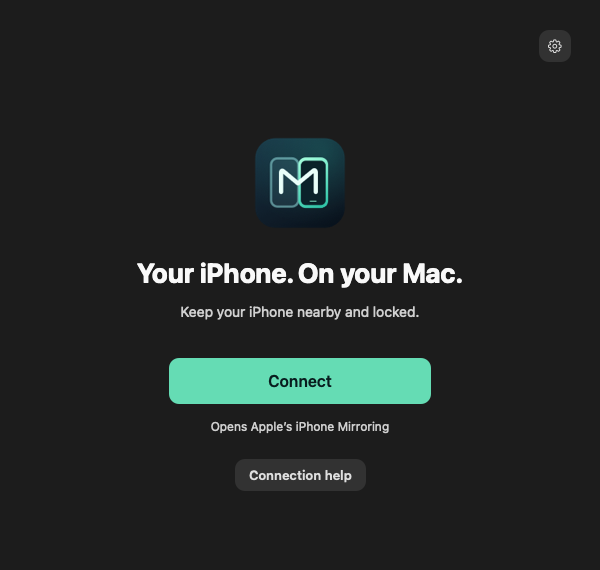
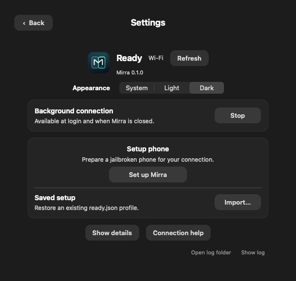
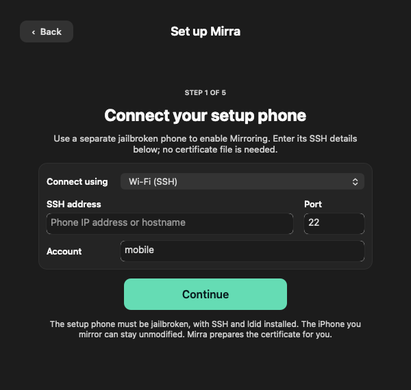
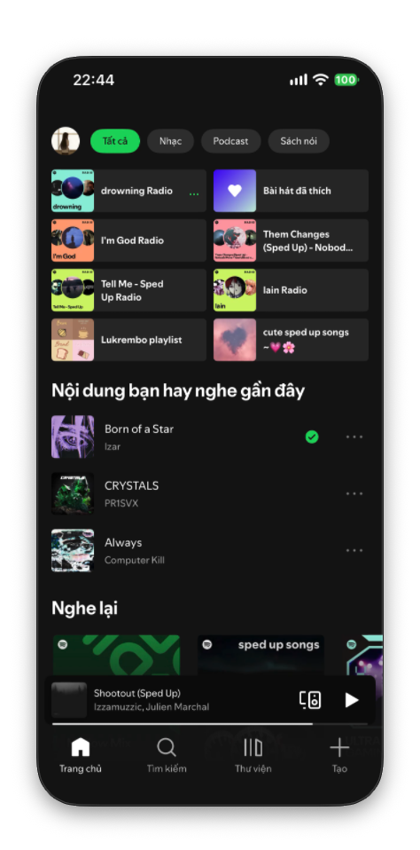
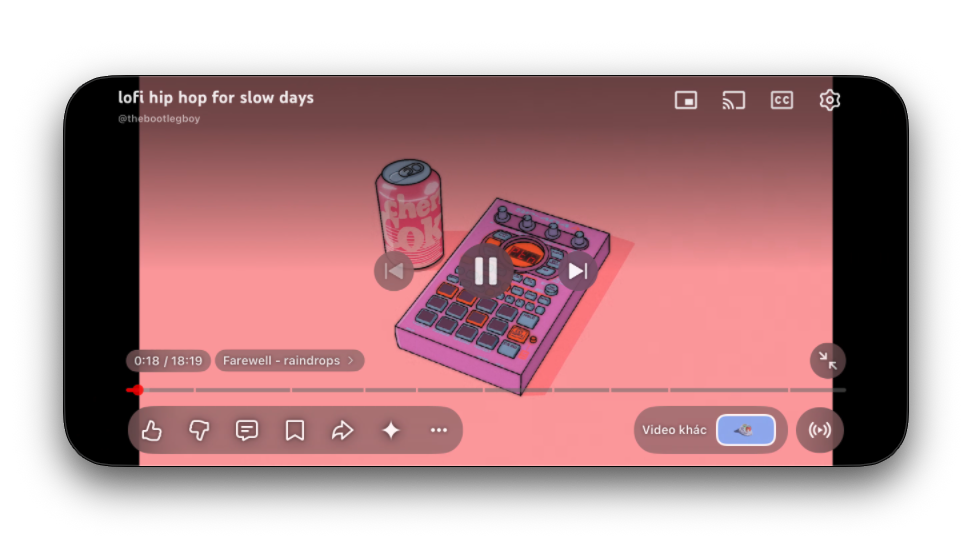

# Demo images

| Home | Settings |
| --- | --- |
|  |  |

| Spotify | YouTube |
| --- | --- |
|  |  |

## Update images

Mirra UI images use the app's preview mode. The iPhone Mirroring images are
captures from a connected session.

Generate UI previews with `--preview` or `--preview-setup` and `--dark` to keep
the demo appearance consistent. Store preview JSON and raw captures outside
the public source. The icon is generated by `src/app/artwork.m`.

For Mirroring captures, use a screen without private messages, notifications,
account information or personal content. Remove image metadata, inspect the
result and add new assets to `config/sources.json`. The source exporter validates
public PNGs before packaging.
